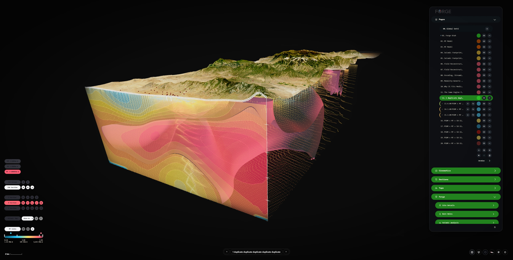
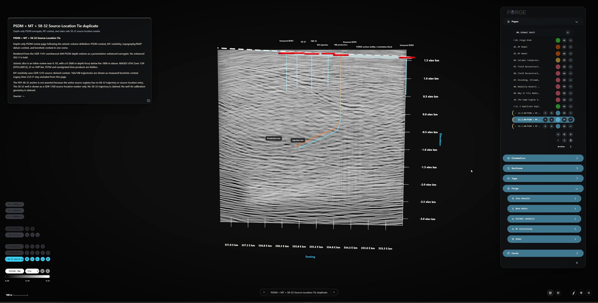

# GEODE / GeoSee

**Free, open-source geoscience visualization and exploration**

**Status: Research and software-development alpha**

GeoSee is the working geoscience application in the GEODE repository. It began as a technical capabilities demonstration that brought geological, geophysical, geographic and survey information together in an interactive 3D environment. It is being retooled for free public geoscience use, with the future goal of enabling geoscientists, researchers and educators to bring supported data into projects, explore spatial relationships and communicate results.

The present application includes substantial viewing, layer control, authoring, presentation and capture code, but **it is not yet a general-purpose bring-your-own-data tool** or a validated engineering measurement system. The separate exploratory cross-domain GEODE OSS V2 concept is not the current product scope.

## Current application architecture

GeoSee is one **React, TypeScript, Three.js and Vite** browser application with an enumerated project catalog. Its main components are:

- **Project and page configuration:** project-specific JSON manifests, environments, page states, overlays, layer definitions and coordinate context.
- **Scientific preparation and loading:** selected source formats are processed offline into browser-ready imagery, geometry, sections, tiles, scalar volumes and metadata. Project-aware loaders read these artifacts; they are not a universal import SDK.
- **Interactive scene:** Three.js scene/layer management, navigation, styles, visibility, section controls and visual presentation.
- **Editor, presenter and capture:** authored camera/page state, presentation transitions, camera paths, still-image and conditional recording/render routes.

The application currently has **no production backend**. The local development server provides file-writing endpoints for editor saves; a static deployment does not include a comparable authenticated project-file persistence service. Saves are not fully transactional. See [the as-built architecture](docs/02-architecture.md).

## Scientific data and current capabilities

| Data family | Actual current pathway | Implemented representations and important limits |
| --- | --- | --- |
| Terrain and elevation | GeoTIFF and elevation rasters wired into included projects | Terrain mesh, relief, styling and exaggeration; not automatic support for arbitrary input CRS/datum |
| Geographic, geology and survey context | Project-schema-specific GeoJSON points, lines and polygons | Roads, water, mapped geology, boundaries, stations, claims, sample/coverage overlays and styling |
| Satellite and site imagery | Prepared project-placed images, including NAIP WebP/JPEG/PNG assets | Terrain draping, opacity, color and footprint/edge controls; Shahbazi projected UAV photographs are previews, not a final orthomosaic |
| Boreholes, logs, assays and geochemistry | Selected offline-prepared GeoJSON/JSON and per-project data loaders | Woodjam bore paths, collar/assay/lithology intervals and geochemistry; Utah trajectories and marker-only wells; currently Utah 16A HCGR/HSGR gamma tracks, not general LAS/DLIS ingestion |
| Seismic reflection | SEG-Y traces/headers processed offline into a GeoSee seismic manifest and binary section/volume artifacts | Prepared seismic curtains, sections, volume views and visual comparison; some source navigation is approximate and time/depth registration is unverified |
| Magnetotelluric (MT) and inversion outputs | EDI stations and inversion models prepared offline into station/QC GeoJSON, tiled points and scalar/mesh products | Station markers, modeled resistivity points, scalar volume, slices and threshold/iso surfaces; inverse-model values are **not** direct measurements of underground material |
| Survey scans, point clouds and surfaces | Selected XYZ/ASCII/CSV source data prepared offline into JSON/binary tiles, mesh and contour previews | Shahbazi source-derived point/tile previews, separate surfaces, contours, GCP/camera quality-assurance context; not accepted full-resolution survey or stockpile-volume measurement |
| Derived surfaces and scalar volumes | Manifest-described JSON and binary data (`.bin`, `.u8`, optional `.f32`) | Project-specific layered, clipped and sectioned display with selected scalar/iso controls; source transforms and registration require independent review |

**Input limitations:** GeoSee's functioning browser loaders are largely tied to the included projects and their schema/manifest wiring. Raw SEG-Y, EDI and survey files are **not generally imported directly in the browser**. The Utah FORGE file-drop interface stages files for review; it does not automatically validate, interpret, create new project layers or display them. General LAS/LAZ import, full Potree/EPT point-cloud streaming and final GLB/glTF survey pipelines are not completed universal routes.

See the [dataset map and provenance notes](docs/dev-context/Dataset-Map.md) for source formats, prepared artifacts, per-project status and uncertainty.

### Included projects

- **Utah FORGE:** public terrain and imagery, MT station and model-derived resistivity representations, offline-prepared seismic products, wells, logs, sections and layered scientific visualizations. Its declared coordinate frame does not establish verified registration; some legacy seismic lines use approximate fallback placement.
- **Woodjam:** terrain, drilling and assay/lithology representations, geology, soil/geochemical samples, survey footprints and geographic context. Certain target/anomaly overlays are interpretations, not verified measurements.
- **Shahbazi Gravel Pit:** TLS/UAV and photogrammetric prepared previews, point tiles, separate interpolated surfaces, contours, camera/GCP context and projected photography. Preview geometry and photos are not a calibrated final survey, orthomosaic, completed Potree stream or accepted quarry-volume calculation.
- **Base GUI:** a development/editing template for shared interface and environment defaults, not an independently generated geoscience project. The current **Add New Project** action opens this existing template; it does not create a new self-contained user project.

## Example visualizations





*Owner-supplied Utah FORGE captures illustrate application appearance and project-specific scientific representations. They are not independent evidence of correct data registration, verified measurements, accepted interactions or an approved export workflow. [Screenshot provenance, original-image attribution and the other retained views](docs/assets/screenshots/GEODE-SELECTED-GALLERY.md).*

## Interaction, authoring and capture

Existing projects provide layer visibility/styling, navigation, section and environment controls, authored pages, page transitions and presenter views. The **Shahbazi Audience Lens** is runtime-specific and does not constitute general persistent multi-audience project authoring.

Capture Director contains source-implemented still-image, realtime recording, frame sequence and browser/local video-encoding paths. **Actual usable output varies by browser, codec, GPU/memory, resolution and local renderer configuration.** Complete acceptance of MP4, high-resolution imagery, external render jobs and cross-browser output fidelity has not been established. A render-job specification is not itself a finished video.

Project/file edits made through the local development-authoring server can change checkout files. Static builds do not provide equivalent hosted project saving.

## Current limitations and development direction

The included examples use prepared scientific assets and manually/project-configured loaders. A guided import workflow, independent creation/persistence of new projects, general user-data processing, reproducible source regeneration from archived inputs and reliable packaged outputs remain incomplete.

Horizontal coordinate reference systems, vertical datums, alignment between different data sources, seismic time/depth conversion and interpretation or interpolation uncertainty have **not been comprehensively independently validated**. Declared EPSG codes, stored transforms, visually aligned scenes and passing source tests are not evidence of survey-grade accuracy.

**Owner-approved W3 future product direction, 14 November 2026 (not yet implemented):**

- **Gate A — curated-example public acceptance:** guided exploration of included scientific examples, clear source/limitations, and an independently acceptance-tested PNG output.
- **Gate B — first independently usable public MVP:** **desktop, single-user, local-first**, with one constrained **2D WGS84 GeoJSON** import path, independent local project creation, basic layer/attribute inspection and provenance, a portable **JSON save/reopen** workflow, and labelled **PNG output**.

These are adopted **future targets**, not working features of the current alpha. The source requirements are recorded in [owner-approved W3 direction](https://app.notion.com/p/418fb09932768185a02cf9cb3492fb3e) and the **unmerged** [W3 draft PR #8](https://github.com/jamespatrickjackson-lang/GEODE/pull/8). Exact geometry subset, CRS transformation and precision thresholds, data/vertex caps, supported browsers, performance, third-party rights and release acceptance remain to be verified or decided through engineering/W4. Neither video acceptance nor broad native scientific imports are first-MVP commitments.

## Run locally

Node.js and npm are required. The audited CI uses Node 20 on Ubuntu; some historical local verification used Node 20/24 on Windows. Python is needed for selected source-preparation and test workflows, not ordinary project viewing.

```bash
git clone https://github.com/jamespatrickjackson-lang/GEODE.git
cd GEODE
npm ci
npm run dev -- --host 127.0.0.1 --port 5189 --strictPort
```

Open `http://127.0.0.1:5189/?project=utah-forge` for a prepared geophysics example, or use the landing project selection screen.

**Suggested first-use walkthrough (not a recorded acceptance test):** open Utah FORGE and inspect the terrain and active project layers; navigate and adjust available layer/section controls; inspect page navigation and presenter/editor controls without assuming all output modes have been accepted. Other preconfigured routes include `?project=woodjam` and `?project=case-study-b`.

**Development safety:** Use a disposable checkout for authoring experiments; local editor saves can modify the project/page/overlay files. Keep the Vite authoring server on trusted loopback. Do not expose its write endpoints as a public multi-user service. This setup does not create or save an independent new user project.

## Verification status

At the audited `main` commit [`29d9c4c7eee77ac1b104289b09b1382c574145d0`](https://github.com/jamespatrickjackson-lang/GEODE/commit/29d9c4c7eee77ac1b104289b09b1382c574145d0), [GitHub Actions run 43516222592](https://github.com/jamespatrickjackson-lang/GEODE/actions/runs/43516222592) passed the configured Ubuntu/Node 20 build and source/asset guards, including **679/679 source/tool tests**. Historical limited Chrome/Chromium smoke tests are recorded separately. These checks do **not** establish a complete Playwright browser-suite pass, acceptance of this staged README branch, all image/video codecs, cross-platform reliability or independent scientific verification and validation.

See [the dated release verification record](docs/GEODE-release-verification.md) for commands, commit-specific evidence, historical failures and limitations.

## Scientific and engineering-use warning

**Research software under active development. Not qualified for professional engineering or safety-critical decisions.** The application includes original, source-derived, modeled, preview, synthetic and unfinished scientific content that must not be conflated. It has not undergone comprehensive independent verification and validation of data registration, measurement, coordinate/vertical-datum transformation, seismic time/depth geometry, geophysical interpretation or exported results. **Visual alignment is not proof of numerical accuracy.** Do not rely on this software alone for engineering design, drilling decisions, resource estimates, hazard/safety assessments, regulatory submissions or other consequential decisions. Such use requires independent source, method and result verification by appropriately qualified professionals.

## Licence and source rights

GEODE-authored software is released under [Apache License 2.0](LICENSE), subject to its terms. Third-party scientific datasets, imagery, source publications and derivatives retain their applicable rights and attribution conditions and are not automatically relicensed by the software licence. See [NOTICE](NOTICE) and [licensing and source-rights guidance](docs/LICENSING.md).
