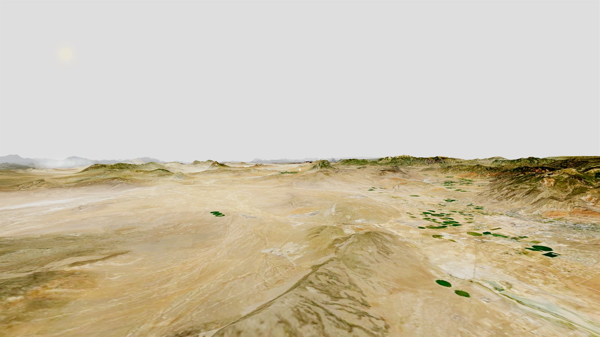
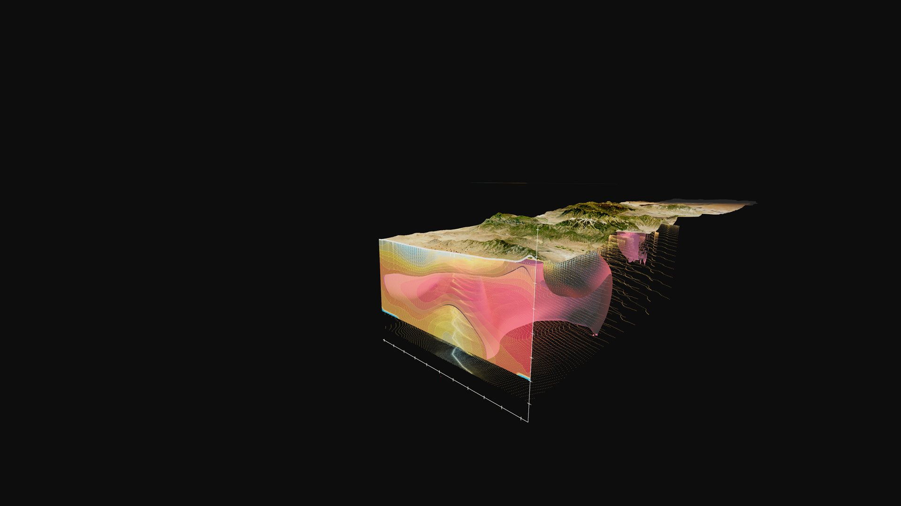
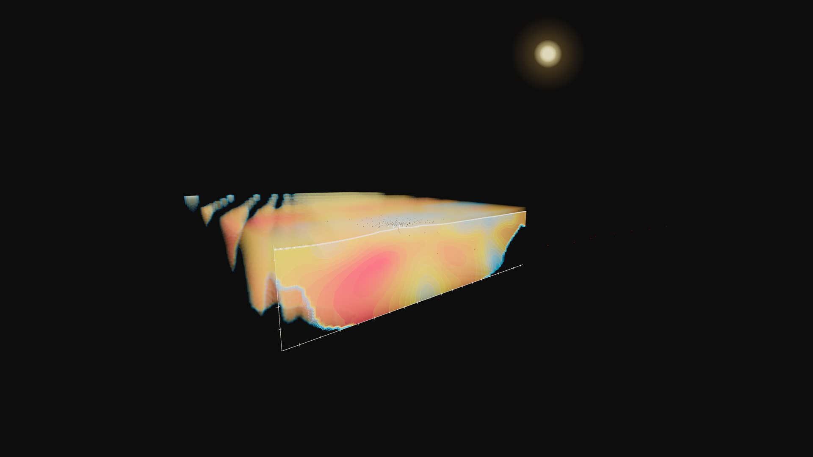
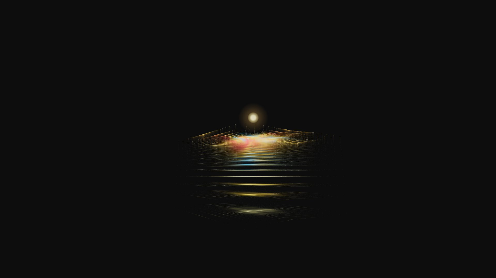
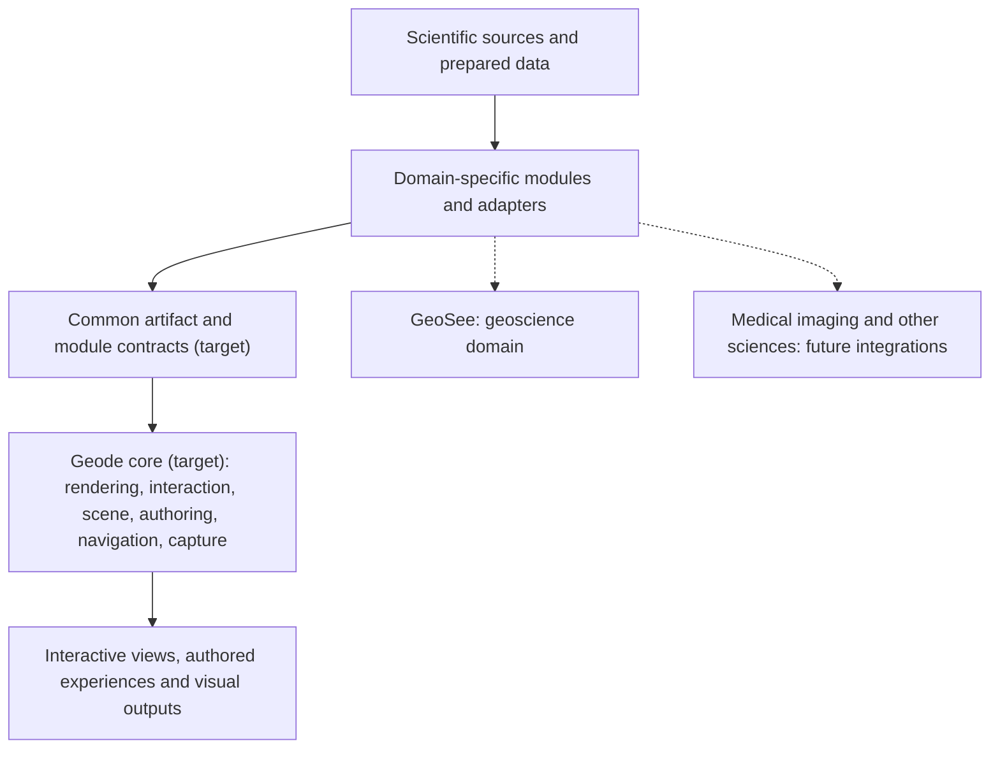

# Geode

## One visualization foundation. A world of scientific possibilities


GEODE is a community-oriented, open-source scientific visualization initiative developed to make advanced imaging, spatial-data exploration and visual communication more accessible.

The project is intended for researchers, universities, schools, scientific institutions and independent developers. Its objective is to reduce the need to repeatedly build the same visualization and interaction capabilities across different scientific disciplines, allowing teams to concentrate their effort on the scientific challenges unique to their work.

GEODE is not being developed as a commercial software service. Its purpose is to establish a freely accessible and extensible foundation that the scientific community can use, adapt and develop further.

GeoSee is the first substantial working implementation, focused on geoscience and subsurface visualization. The broader GEODE architecture, including an independently reusable core and additional scientific-domain integrations, remains under development.

Scientific visualization spans an extraordinary range of disciplines, instruments and data types. Yet the software used to explore scientific information is often fragmented and developed in isolation. Geoscience, medical imaging, industrial scanning and emerging sensing systems each require specialized data handling, but they also share fundamental needs: representing complex information, navigating it in two and three dimensions, exploring spatial relationships and communicating results. Too often, these common capabilities are rebuilt for each application.

**Geode exists to bridge that gap.**

Geode aims to give the scientific community a shared, extensible visualization foundation. The proposed platform separates common capabilities, such as rendering, interaction, scene navigation, authoring and capture, from specialized modules responsible for the formats, representations and workflows of individual disciplines. Its long-term direction is an open-source platform that scientific and engineering teams can build upon, rather than another viewer that must be recreated from the ground up.

For teams building scientific instruments, imaging products and data-rich applications, the goal is to concentrate more development effort on the science and functionality that make each product unique. Geode is intended to provide the common visualization environment beneath those specialized applications.

### From vision to working software

**GeoSee is the first substantial implementation of Geode's vision.** It is a working scientific visualization and authoring alpha for geoscience, bringing real-world terrain, geographic imagery, geological and survey context, boreholes, seismic sections and volumetric geophysical representations into an interactive 3D environment.

GeoSee goes beyond viewing: datasets can be combined or isolated, sections and volumes explored, scene environments configured, presentation pages authored, camera motion animated and still or video outputs produced through supported capture paths. Built with **React, TypeScript, Three.js and Vite**, it supplies a substantial executable and source-tested foundation for Geode's broader architectural direction.

**What is in this repository:** the GeoSee geoscience application, its project data and preparation tools, authoring/presentation/capture subsystems, tests and engineering records. The independent Geode core, reusable module contracts and integrations into other scientific domains remain development objectives. The planned open-source direction also requires a separate software licence decision.

## Geode in action

**Complex data. One interactive environment.**

The Utah FORGE geothermal example shows terrain and geographic context alongside prepared subsurface scientific representations. These images demonstrate the working geoscience renderer, layering and section views, not the complete planned multi-domain platform.

### Exploring the subsurface

| Terrain and geographic context | Subsurface visualization |
| --- | --- |
|  |  |
| Real-world terrain and prepared imagery provide the context for exploration. | Surface and subsurface representations can be viewed together in a spatial scene. |

| Scientific sectioning | Layered volume visualization |
| --- | --- |
|  |  |
| A sectional representation helps reveal spatial relationships within prepared models. | Layered scalar and volume rendering exposes information that is difficult to communicate in a flat image. |

*Authentic captures from the GeoSee application, supplied by the repository owner and optimized for the web. Images are evidence of visualization capabilities, not independently certified interpretations, registration or measurements. [Image provenance and source details](docs/assets/screenshots/README.md).*

### More than a viewer

The implemented GeoSee toolchain includes [layer and scene controls](src/editor/layerControls/), [page-based authoring](src/pages/), [audience-specific presentation](src/audience/), [environment configuration](src/editor/), and [Capture Director](docs/capture-director/README.md). Together they support a progression from exploring scientific information to arranging and communicating it as a guided visual experience.

**Visual evidence still to add:** authentic screenshots of the editor, layers and environment controls, an authored presentation, and the Capture Director timeline/camera path. These interfaces are described and source-linked below, but are not shown in the current four-image gallery.

## From scientific data to interactive experience

The Utah FORGE example connects multiple parts of GeoSee's working implementation. A typical project workflow uses the following stages; the linked subsystems exist in the repository, but the complete sequence has **not** been independently reverified here as one recorded end-to-end acceptance run.

| Stage | What the application and tooling do | Source and implementation evidence |
| --- | --- | --- |
| **1. Scientific inputs** | Start from project-specific terrain, geospatial context, magnetotelluric and seismic source material, retaining source and interpretation boundaries. | [Utah FORGE project](projects/utah-forge/), [dataset map](docs/dev-context/Dataset-Map.md) |
| **2. Prepare and describe** | Convert selected inputs into browser-ready products and describe coordinate mapping, scalar dimensions, metadata and source provenance in project-specific manifests. | [Seismic preparation](prep/build_utah_forge_seismic_browser.py), [computed-artifact pipeline](docs/dev-context/Computed-Artifact-Pipeline.md) |
| **3. Assemble the scene** | Load prepared terrain, imagery, stations and subsurface representations into the interactive 3D scene. | [Scene manager](src/scene/SceneManager.ts), [loaders](src/loaders/), [MT subsystem](src/mtResistivity/) |
| **4. Explore and compose** | Control visible layers, examine sections and volume representations, adjust styles and configure the scene to emphasize a scientific relationship. | [Section runtime](src/scene/section/), [layer controls](src/editor/layerControls/) |
| **5. Author an explanation** | Save page-specific camera and layer states, then navigate them in a presenter flow for a particular audience. | [Pages](src/pages/), [editor](src/editor/), [presenter](src/presenter/) |
| **6. Capture and communicate** | Produce supported stills, recordings or frame sequences; format, codec, resolution and rendering parity remain environment-dependent. | [Capture Director](src/capture/), [production notes](docs/capture-director/README.md) |

**Boundary:** The present workflow uses project-wired loaders and prepared inputs. It is not a universal scientific file importer, automatically validated data-processing pipeline or certified quantitative analysis environment.

## Explore the implementation

- **[Implementation architecture](docs/02-architecture.md):** Current application structure, rendering, data and authoring systems.
- **[Scientific datasets and provenance](docs/dev-context/Dataset-Map.md):** Source data, prepared assets and scientific representation boundaries.
- **[Capture Director](docs/capture-director/README.md):** Camera paths, timeline, still and video capture tooling.
- **[Engineering and release verification](docs/GEODE-release-verification.md):** Test results, release checks, known limitations and follow-up work.
- **[Decision history](docs/03-decisions.md):** Traceable development choices and their rationale.

## Run locally

### Quick start

The application runs locally in the browser through a Vite development server. Node **20.20.2** and **24.22.2** were used for the documented Windows verification runs; CI uses Node 20 on Ubuntu. Python 3 is only required for selected preprocessing and Python-backed tests, not for opening the browser application.

```sh
git clone https://github.com/jamespatrickjackson-lang/GEODE.git
cd GEODE
npm ci
npm run dev -- --host 127.0.0.1 --port 5189 --strictPort
```

Open **http://127.0.0.1:5189** in a browser. The application offers a project landing screen. To go directly to the principal geophysics example, open **http://127.0.0.1:5189/?project=utah-forge**.

### First five minutes: a reviewer walkthrough

1. **Load Utah FORGE.** Confirm that the terrain/environment appears. Loading and visible layers depend on the included prepared project assets and the selected scene/page state.
2. **Explore the spatial scene.** Navigate the terrain and inspect the available geological/geophysical representations and their layer or section controls. Use the project interface to vary the view rather than treating the screenshots as fixed rendered outputs.
3. **Inspect the authoring and presenter controls.** Open the editor/page controls, examine how camera and layer states contribute to authored pages, and try a supported presenter navigation path. Capture Director is a separate deeper feature to inspect after the basic scene.

This is a **suggested first-use route**, not a recorded browser acceptance script. Do not overwrite project state needed for your own work. Direct project routes include `/?project=woodjam`, `/?project=utah-forge`, `/?project=case-study-b` and `/?project=base-gui`.

### Build and verification commands

```sh
npm run build
npm run check:gate
npm run check:pages
npm run check:runtime-assets
python -m pip install -r tools/requirements-test.txt
npm run test:tools
```

The repository's [release verification record](docs/GEODE-release-verification.md) documents observed outcomes and the CI environment. On **12 November 2026**, the published [GitHub Actions run 43302400916](https://github.com/jamespatrickjackson-lang/GEODE/actions/runs/43302400916) passed the production build, runtime-asset checks and **679 of 679 tests**. These results apply to that run and commit, not every browser configuration or future change.

### Local development boundaries

`npm ci` enables the repository's pre-commit checks through its prepare script. The authoring interface uses **development-only Vite endpoints** that can write project/page state to the checkout; use a disposable clone when exploring. Keep the dev server bound to loopback. It is **not** a hardened public editing service. Static builds omit those development write endpoints, so don't assume equivalent hosted edit/publish functionality.

The build includes prepared project/runtime data and FFmpeg assets, while excluding raw-source buckets and selected archives. Some source regeneration inputs may live outside Git. See [archive mapping](docs/archive-map.md), [archive manifest](docs/archive-manifest.json) and [release verification](docs/GEODE-release-verification.md). Historical local `C:\GeoSee\GeoSee_Archive` paths are developer provenance, not portable installation instructions.

## Scientific visualization and data pipelines

| Capability | Implementation and representative evidence |
| --- | --- |
| Real terrain and elevation | [GeoTIFF terrain loader](src/loaders/loadTerrain.ts), [coordinate transforms](src/loaders/geoTransform.ts), [topographic runtime](src/topoMap/runtime.ts), [Woodjam terrain](data/terrain_woodjam.tif) |
| Satellite and orthophoto overlays | Terrain-draped prepared imagery, opacity, image adjustments, footprint clipping and edge fading in [Topo Map](src/topoMap/) and its [editor](src/editor/topoMap/TopoMapPanel.tsx) |
| Geographic context | Project-wired GeoJSON points, lines and polygons for roads, hydrography, utilities, claims, geology and surveys; [loaders](src/loaders/), [Woodjam data](docs/woodjam/data-manifest.md) |
| Drillholes, logs, assays and geochemistry | Source-derived trajectories, borehole/log views, assay and sample context; [runtime data](data/), [Utah FORGE project](projects/utah-forge/project.json) |
| Seismic sections and 3D volumes | [Prepared seismic loader](src/loaders/loadSeismicBrowser.ts), [offline SEG-Y preparation](prep/build_utah_forge_seismic_browser.py), [source gates](tools/validate-seismic-source-gates.mjs) |
| MT resistivity | Station context, tiled inversion cells, scalar volumes, slices, threshold surfaces and iso-bands; [MT subsystem](src/mtResistivity/), [scalar-volume loader](src/loaders/loadScalarVolume.ts) |
| Point clouds, surfaces and photogrammetry | Prepared point/tile and mesh previews, contours, camera frustums and projected photography; [Shahbazi processing records](projects/case-study-b/data/processed/shahbazi_gravel_pit/README.md) |
| Composition and sectioning | Layer visibility/style/opacity, clipping, section frames, independent object visibility and working-area focus; [scene controller](src/scene/SceneManager.ts), [section runtime](src/scene/section/), [layer controls](src/editor/layerControls/) |

Spatial manifests, scene origins and dataset-specific transforms allow layers to share a view. They do not automatically establish accepted registration across coordinate systems, vertical datums, or seismic time/depth domains. Source, derived, preview, synthetic and future content must remain distinguishable. Some seismic registration metadata explicitly remains unverified.

### Supported runtime inputs, preparation formats and future targets

| Route | Formats and limits |
| --- | --- |
| Direct, project-wired runtime inputs | GeoTIFF terrain; schema-specific GeoJSON; prepared images; GeoSee JSON manifests/mesh previews; manifest-described `.bin`, `.u8` and optional `.f32` products |
| Offline scientific preparation | SEG-Y traces and headers → seismic browser products; EDI MT responses → station/QC products; ASCII/XYZ/CSV and survey inputs → prepared clouds, tables, surfaces or volumes |
| Future or placeholder targets | General LAS/LAZ import, full Potree clouds and final GLB/glTF/textured survey products where a manifest lists only `futureTargets`; these are not completed universal importers |

Binary arrays need their dimensions, coordinate mapping, scalar ranges and other manifest metadata. The Utah FORGE file-drop interface stages intake; it does not automatically validate, interpret or display arbitrary scientific files. PDF/Excel/source archives serve as reference or preprocessing material.

## Interaction, authoring and presentation

Geode's value proposition is broader than rendering a scene. GeoSee's implemented interaction and authoring systems help someone **inspect**, **organize**, **explain** and **communicate** spatial information. These are software interaction capabilities, not claims that a particular scientific interpretation is correct or that formal usability validation has been completed.

### Explore and configure

Users can navigate scene and terrain context, work with layer visibility and opacity, inspect sections, change representation styles and adjust the environmental settings available to a project. The [scene controller](src/scene/SceneManager.ts), [layer controls](src/editor/layerControls/), [section runtime](src/scene/section/) and [MT visualization subsystem](src/mtResistivity/) show how specialized scientific representations are wired into a common visual experience.

Environment controls include lighting, sun appearance and contribution, fog, local atmospheric volumes, terrain materials and post-processing. Branding and layout controls configure logos, headers, menus, HUDs and overlays. The [developer inspector](src/editor/DevModeInspector.tsx) edits registered layout properties; it is not a universal no-code application builder.

### Author a guided experience

The [project catalog](src/projects/projectCatalogRuntime.ts) selects distinct project loads. [Pages](src/pages/) and the [editor](src/editor/) manage camera poses, layer visibility, overrides, page creation/duplication/reordering and presentation content. [Transition executors](src/scene/transitions/) coordinate changes in opacity, sections, scalar styles and environment state within a project. Switching between projects is not an automatic geospatial flythrough between coordinate systems.

[Audience-specific views](src/audience/) and [presentation cards](src/presenter/OverlayDisplay.tsx) allow different explanations of the same project to be composed for technical and nontechnical audiences. The intended output is an authored, interactive walkthrough rather than only a single screenshot or raw 3D dataset.

### Communicate and capture

The working environment supports authored page navigation and multiple capture paths. It does **not** yet constitute a fully verified browser-hosted publishing or generalized export service. Details of the cinematic system, including supported still/video pathways and limitations, appear in the next section.

## Cinematic capture

[Capture Director](src/capture/) includes Bézier spline camera paths with independent handles, G0–G3 continuity controls, keyframes, holds, a timeline and deterministic camera sampling. Page/scene choreography and camera motion share a clock while retaining separate responsibilities.

Implemented capture paths include realtime screen/viewport recording, composited overlays, still capture, deterministic frame sequences and video encoding through browser or local FFmpeg pipelines. See [production notes](docs/capture-director/README.md), [browser encoding constraints](docs/capture-director/ffmpeg-browser-encode-constraints.md) and [spline runtime tests](tests/tools/capture-director-camera-path-v3-spline-runtime.test.mjs).

High-resolution paths include configured 4K output and tiled still rendering for larger outputs such as 8K. GPU memory, browser/codec support, effects parity and tile seams remain practical constraints. The presence of these code paths is not a claim that every resolution, codec or multipage export has passed visual acceptance.

## Geode architecture and extensibility

The first implementation and the long-term platform objective should not be confused. **GeoSee is a bundled geoscience application today.** The goal is to extract its reusable visualization, interaction and authoring capabilities into a **domain-independent Geode core**, then connect specialized scientific modules through explicit data and integration contracts.

### Current implementation

The published application shell selects projects and page states; project-specific preparation provides browser-ready scientific representations; loaders feed the Three.js scene; editor controls author project and page overrides; presenter and capture systems consume the resulting state.

| Area | Entry point |
| --- | --- |
| React application and project/page loading | [App.tsx](src/App.tsx), [loadPages.ts](src/pages/loadPages.ts) |
| Rendering, state and layer loading | [scene](src/scene/), [loaders](src/loaders/), [topography](src/topoMap/) |
| Authoring, presentation and capture | [editor](src/editor/), [pages](src/pages/), [presenter](src/presenter/), [capture](src/capture/) |
| Scientific source preparation | [prep](prep/), [computed-artifact pipeline](docs/dev-context/Computed-Artifact-Pipeline.md) |
| Tests, guards and CI | [tests](tests/), [tools](tools/), [GitHub Actions](.github/workflows/checks.yml) |
| Decisions, risks and agent context | [decisions](docs/03-decisions.md), [risk register](docs/risk-management/GeoSee-Risk-Register.md), [AGENTS.md](AGENTS.md), [active build context](docs/dev-context/Active-Build-Context.md) |

These are implemented subsystem boundaries, not proof that the common core already operates independently of the geoscience-specific code. The current [architecture document](docs/02-architecture.md) and [decision log](docs/03-decisions.md) describe the published foundation.

### Proposed shared platform



*Conceptual **target architecture**, not a diagram of an independently deployed module host. Medical-imaging work exists separately and is not part of the public GEODE main release.*

| Shared foundation: planned responsibility | Scientific module: planned responsibility |
| --- | --- |
| 2D/3D rendering surfaces, scene/camera and consistent navigation | Interpret domain formats, units, acquisition and scientific semantics |
| Selection, interaction primitives, overlays, legends, authoring and capture | Supply domain views, styling rules, tools and workflow-specific presentation |
| Common renderable artifact interfaces, module lifecycle and compatibility contracts | Convert prepared inputs into contracted artifacts and declare provenance/limitations |

The intended benefit is **reuse without forcing unrelated sciences into one data model**. A scientific instrument or data team would integrate through a documented module/adapter boundary and retain responsibility for discipline-specific processing and verification. This is a design objective, not a demonstrated cross-domain integration benchmark.

A separate **DMT** engineering governance and enforcement methodology is under development; it is not a functioning module of this published application. Likewise, the independent clinical Geode Workbench is a separate prototype, not a deployed feature in this repository.

## Engineering approach and verification

Geode's development is **human-directed and AI-assisted**. The design direction, architecture decisions, scope boundaries, integration choices and acceptance judgments are owned by the developer. AI coding assistants are used in implementation and iteration; their use is a development method, **not** a claim that an AI assistant is embedded in the user-facing application.

The repository provides more meaningful engineering evidence than a tool label: runnable application code, project-specific scientific preparation and source gates, decision records, automated checks, a release verification record, and CI execution on the published branch.

| Engineering concern | Reviewable evidence |
| --- | --- |
| Requirements, decisions and known risks | [Decision history](docs/03-decisions.md), [risk register](docs/risk-management/GeoSee-Risk-Register.md), [development context](docs/dev-context/Active-Build-Context.md) |
| Scientific integrity and source mapping | [Dataset map](docs/dev-context/Dataset-Map.md), [computed-artifact pipeline](docs/dev-context/Computed-Artifact-Pipeline.md), [seismic source gates](tools/validate-seismic-source-gates.mjs) |
| Source-level testing and deterministic behavior | [Tool/source tests](tests/tools/), [capture spline runtime test](tests/tools/capture-director-camera-path-v3-spline-runtime.test.mjs), [checks workflow](.github/workflows/checks.yml) |
| Published build and CI evidence | [GitHub Actions run, 12 Nov 2026](https://github.com/jamespatrickjackson-lang/GEODE/actions/runs/43302400916), [release verification](docs/GEODE-release-verification.md) |

**Verified snapshot, 12 November 2026:** At published commit [`b50916fe`](https://github.com/jamespatrickjackson-lang/GEODE/commit/b50916fe4cb987280ad1148a4314752f0e573a1c), the release checks reported a successful production build, runtime-asset validation and **679 passing tests out of 679**. This does not establish scientifically certified accuracy, universal browser compatibility or the completion of all export paths. Specific acceptance results and known failures are recorded in the [verification report](docs/GEODE-release-verification.md).

Representative review trails include trace-header-driven seismic geometry and source gating, transition identity/interruption handling, and deterministic spline/camera sampling. Review the linked source and test evidence rather than inferring correctness from line count or Git history. The development risk register is not an audited quality management system and does not establish regulatory conformity.

## Demonstration projects

| Project | What it demonstrates | Interpretation boundary |
| --- | --- | --- |
| [Utah FORGE](projects/utah-forge/) | Terrain/imagery, geothermal context, MT inversion representations, seismic sections/volumes, station and well context, sectioning and authored scientific views | Source-derived visualization; unresolved registration and quantitative validation limits remain explicit |
| [Woodjam](projects/woodjam/) | Terrain, exploration/drilling, assays/geochemistry, geology, roads/water/claims and authored walkthroughs | Measured/source-derived context and interpretation layers retain distinct meanings |
| [Shahbazi Gravel Pit](projects/case-study-b/) | UAV/survey material, TLS previews, prepared meshes/contours, cameras and photography overlays | Demo coordinates and preview geometry; placeholders are not final survey products |
| [Base GUI](projects/base-gui/) | Shared interface, scene/environment and presentation authoring | Local studio/template context, not a scientific survey |

## Development status and roadmap

| Area | Current state | Next evidence or engineering milestone |
| --- | --- | --- |
| **GeoSee geoscience application** | Working research/software alpha in this public repository | Broader browser acceptance, interaction polish and repeatable demonstrations |
| **Geode reusable core and scientific modules** | Architectural direction; common behaviors remain coupled to GeoSee | Extract stable boundaries, define/version interface contracts and demonstrate independent reuse |
| **Scientific import and data fidelity** | Project-specific preparation, loaders and source distinctions | Improve file-format coverage, registration checks, metadata validation and uncertainty presentation |
| **Authoring and cinematic outputs** | Implemented editor, presenter, path/timeline and selected still/video capture paths | Validate capture/export parity, high-resolution effects, codecs and multi-page workflows |
| **Large scientific data** | Prepared browser-oriented runtime products | Bound memory/performance and expand stress/regression coverage |
| **Other domains and governance tools** | Separate experimental medical/Workbench work; DMT and other projects outside this release | Independent integration, permissions and verification before claiming cross-domain modules |

**Not yet demonstrated:** a separated and versioned cross-domain Geode core, multiple independently integrated scientific modules, unrestricted file-format ingestion, a hardened hosted editing service, certified scientific metrology, or medical-device clearance. These are boundaries, not features hidden behind the UI.

### Scientific interpretation and source boundaries

Project manifests and transforms can place data layers in a common scene, but that does **not** automatically establish accepted alignment between different geographic coordinate systems, vertical datums or seismic time/depth domains. Source, derived, preview, synthetic and future-target data remain distinct. Scientific viewers are responsible for presenting source and uncertainty context, not manufacturing apparent precision.

The developer has reported qualitative comparison of Utah FORGE visuals with literature and external professional feedback, but the underlying dated comparison and review scope have not been independently established. Neither is presented as certified scientific validation or regulatory sign-off. See the [release verification](docs/GEODE-release-verification.md) and [data provenance](docs/dev-context/Dataset-Map.md) for precise evidence boundaries.

## Rights and release status

The repository owner confirmed rights clearance for this release on 12 November 2026. Existing source attribution and provenance remain applicable. No software reuse licence has been selected or added; public visibility alone is not an open-source licence. Dataset terms are distinct from the application's code licence.

[Release verification](docs/GEODE-release-verification.md) records tested commands, failures and publication status. Historical internal-only descriptions document earlier development stages; this README describes the intended public GEODE presentation.
