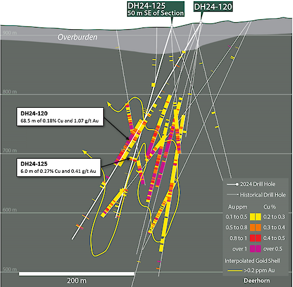

Woodjam carries one of the more complete historical drilling datasets of any junior-stage copper-gold project in British Columbia. Hundreds of holes drilled by previous operators across multiple campaigns established the known deposits and defined the regional alteration footprint. The 2024 program added eleven new holes across three target areas — Deerhorn, Three Firs, and the Southeast Zone — tightening definition where mineralization was already known and stepping out where the geological model suggested mineralization should extend. Drilling is the most expensive single line item in exploration, and what's been spent here gives the next holes more to work from than most projects ever assemble.
